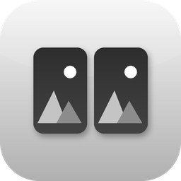
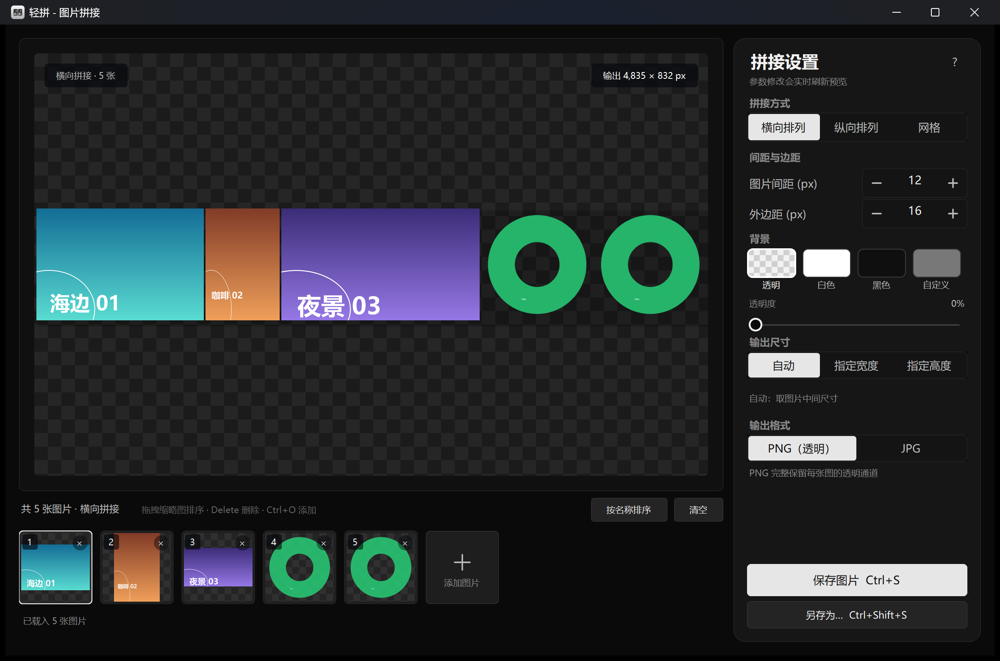
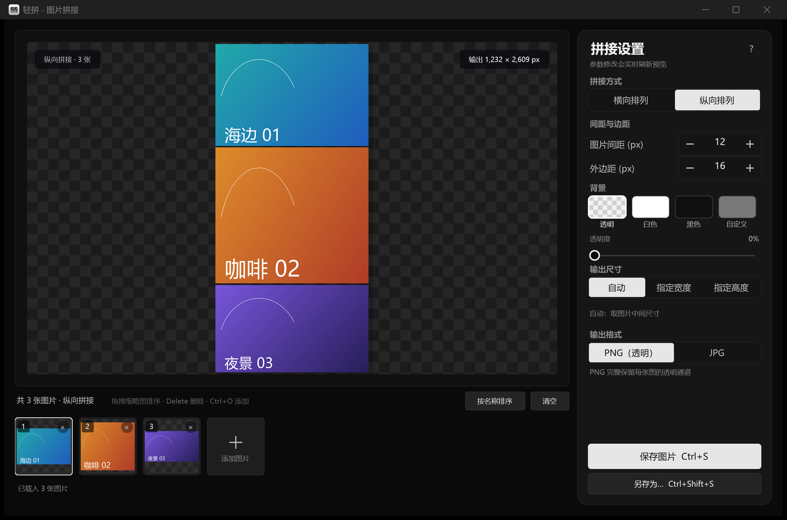
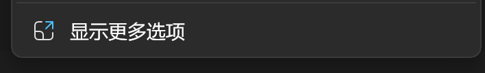
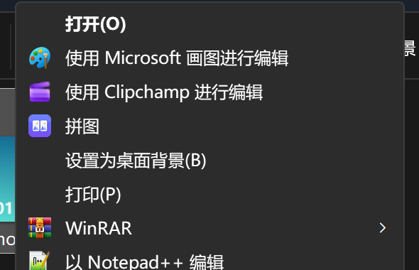
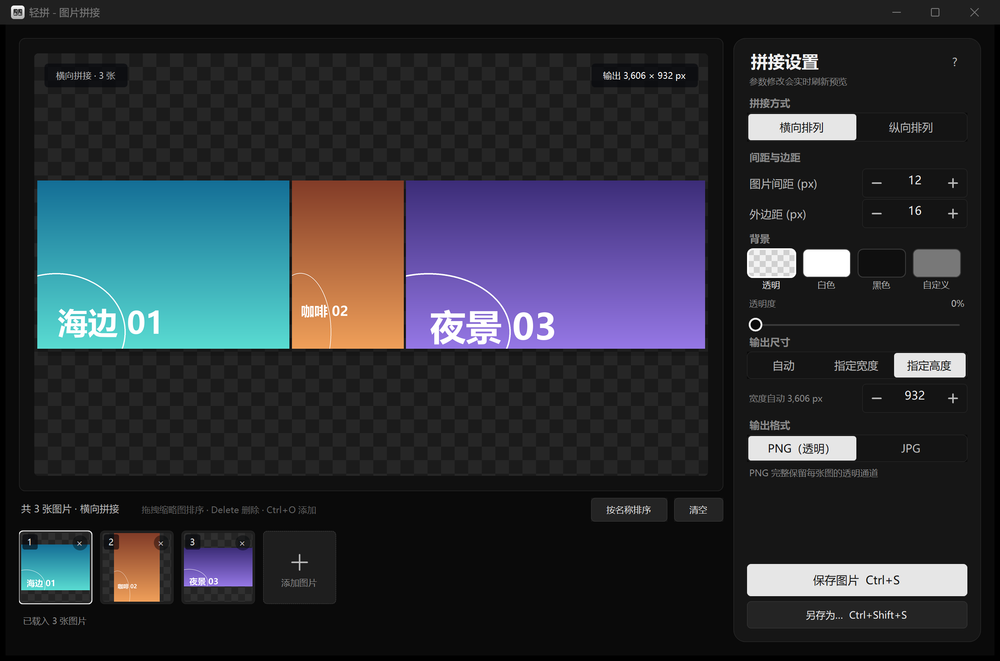
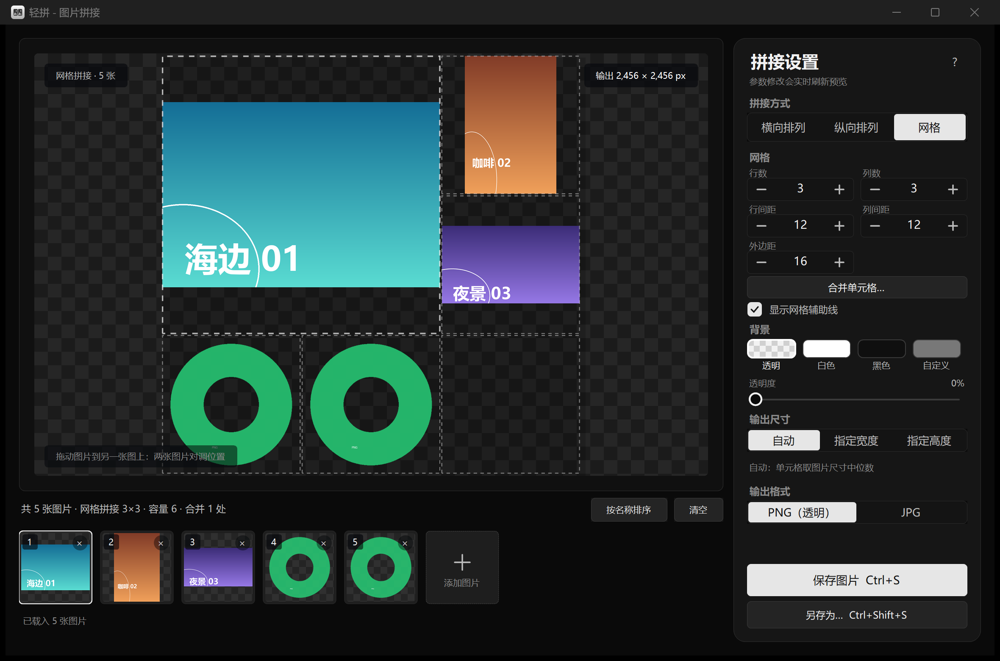
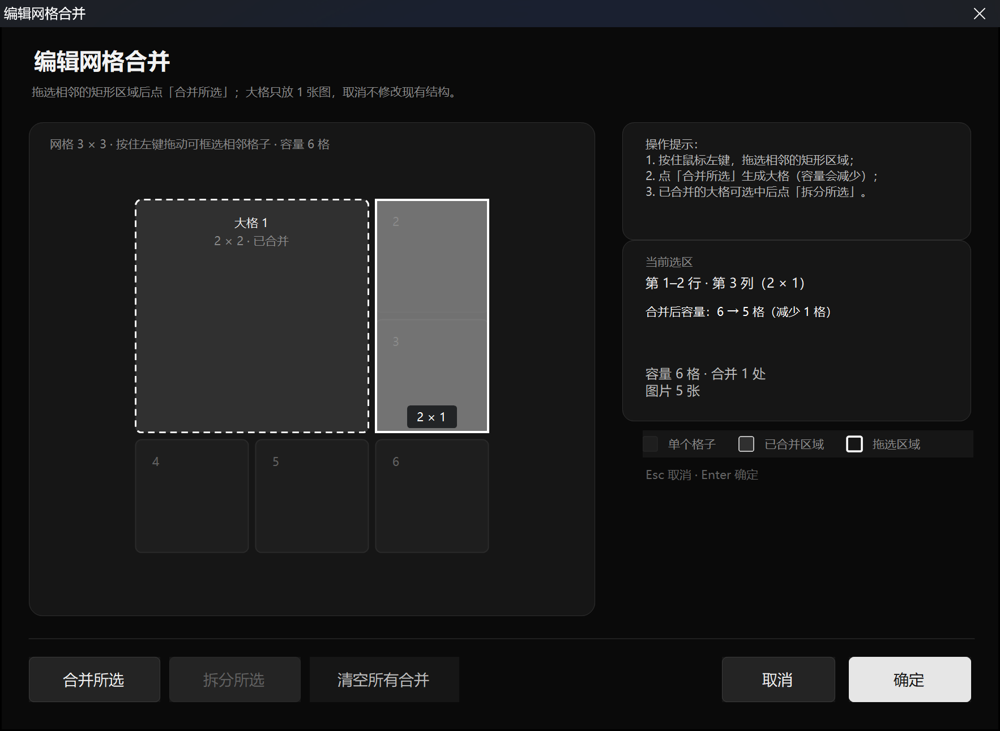

# 轻拼 LightCollage · Windows 右键图片拼接工具



[](https://github.com/ryantxq/LightCollage/actions/workflows/build.yml)
[](LICENSE)
[](https://github.com/ryantxq/LightCollage/releases)
[](https://github.com/ryantxq/LightCollage)

在 Windows 资源管理器里选中一张或多张图片，右键 →「拼图」，即可在预览窗口里横向/纵向/网格拼接，
随时增删图片、调整间距/边距/背景色与透明度，一键保存为 PNG/JPG。

**免安装、秒开、单文件 exe**：不需要 dotnet SDK / 运行时安装包 / 第三方 DLL，不联网、不写系统目录、
不常驻后台。右键菜单只写当前用户注册表（HKCU），**不需要管理员权限**。项目以 MIT 协议开源，源码可审计。

> [下载 Releases](https://github.com/ryantxq/LightCollage/releases) ·
> [问题反馈](https://github.com/ryantxq/LightCollage/issues) ·
> [参与贡献](CONTRIBUTING.md)

---

## 目录

- [功能特性](#功能特性)
- [界面预览](#界面预览)
- [下载安装](#下载安装)
- [系统要求](#系统要求)
- [安装右键菜单](#安装右键菜单)
- [使用说明](#使用说明)
- [快捷键](#快捷键)
- [支持的图片格式](#支持的图片格式)
- [拼接与透明度规则](#拼接与透明度规则)
- [卸载](#卸载)
- [修复右键菜单](#修复右键菜单)
- [构建方法](#构建方法)
- [测试](#测试)
- [项目结构](#项目结构)
- [实现要点](#实现要点)
- [常见问题 FAQ](#常见问题-faq)
- [参与贡献](#参与贡献)
- [开源协议](#开源协议)

---

## 功能特性

- **右键即用**：仅对图片文件显示「拼图」菜单项，单选/多选均可，支持跨文件夹、混合格式选择。
- **单实例收集**：已打开窗口时再次右键「拼图」，新图片会**追加到当前窗口**并唤醒窗口，不会开第二个窗口。
  多个资源管理器调用由命名管道汇总，一次选择只产生一个窗口。
- **实时预览**：横向/纵向/网格拼接实时切换；透明棋盘格预览区，所见即所得；显示最终输出尺寸。
- **网格拼接（v1.1 新增）**：拼接方式增加「网格」，行数×列数可分别设置（各 1–20，默认 3×3），
  行间距、列间距分别可调（0–200 px）；图片按**从左到右、从上到下**顺序填充，最后一行/末尾空格留空
  （显示背景色/透明），网格与横向/纵向一样支持外边距、背景、透明度和输出尺寸。
- **合并单元格（v1.1 新增）**：点「合并单元格…」打开网格合并编辑器，在格子矩阵上拖选矩形后合并成一个大格；
  大格只放 1 张图，其余图片继续按顺序填充；支持拆分所选/清空所有合并；合并后容量不足时多余图片标「未放入」并提示。
- **预览拖动换图（v1.1 新增）**：直接在预览中拖动两张图片即可**对调**顺序，底部缩略图顺序与序号同步；
  横向/纵向/网格三种模式均可用；网格模式可显示仅预览用的网格辅助线（不写入输出）。
- **可调参数**：图片间距（横向/纵向）、行间距/列间距（网格）、外边距（各 0–200 px），背景颜色 + Alpha 透明度（0–255），
  输出尺寸（自动 / 指定宽度 / 指定高度，只能固定一项，另一项按比例自动计算），输出格式 PNG / JPG。
- **键盘输入**：间距、边距、输出尺寸的数字框支持鼠标点击后直接键盘输入，回车确认、Esc 取消。
- **黑白灰界面**：窗口、控件、图标统一黑/白/灰配色，不引入彩色强调色。
- **编辑操作**：底部缩略图列表显示顺序与序号，可拖动排序、单张删除、清空；
  按钮添加 / 拖入文件 / 一次加入多张；「按名称排序」按文件名自然排序（`图2` 排在 `图10` 之前）；
  预览中也可直接拖动图片对调顺序（v1.1）。
- **高质量输出**：GDI+ 高质量插值缩放、32 位 ARGB 合成、自动应用 EXIF 方向（手机照片不会横躺）。
- **智能保存**：默认保存到第一张图片所在目录（目录不可用时回退到「图片」文件夹），
  文件名 `拼图_yyyyMMdd_HHmmss.png`（输出 JPG 时为 `.jpg`），同名自动加序号；
  保存成功后状态栏提供「打开文件夹」。
- **尺寸保护**：输出总像素上限 8000 万、单边上限 32000 px，超限时自动等比缩小并在状态栏提示；
  损坏/超大/不受支持的图片会被跳过并给出可读提示，不影响其他图片。
- **记忆设置**：间距、边距、背景、透明度、排列方式、输出尺寸、输出格式、窗口位置，
  以及网格行数/列数、行间距/列间距、合并结构、网格辅助线开关等自动记忆，
  存放于 `%APPDATA%\LightCollage\settings.ini`。
- **轻量**：单个 exe（约 185 KB）；预览在后台线程解码，参数调整防抖。

## 界面预览

主窗口：左侧为实时预览区，右侧为拼接设置，底部为缩略图栏。

| 默认三图（横向） | 纵向拼接 |
|---|---|
| <br>左侧实时预览、右侧拼接设置、底部缩略图栏 | <br>切换到纵向排列，预览与输出尺寸同步更新 |

右键菜单：Windows 11 的默认菜单是精简版，注册表项位于「显示更多选项」里；Windows 10 经典菜单直接显示。

| Windows 11：显示更多选项 | 经典菜单中的「拼图」 |
|---|---|
| <br>Win11 一级菜单底部的「显示更多选项」，经典菜单项在其内 | <br>经典菜单中的「拼图」项，单选/多选均可用 |

输出尺寸：



指定高度后，宽度按比例自动计算，预览上方实时显示最终输出尺寸。

网格拼接（v1.1 新增）：

| 网格模式（3×3 + 合并大格） | 合并单元格编辑器 |
|---|---|
| <br>行/列与行/列间距可调、合并大格、网格辅助线（仅预览） | <br>在格子矩阵上拖选相邻矩形后合并/拆分/清空 |

网格模式下可直接在预览中拖动图片对调顺序（底部缩略图顺序与序号同步）；容量不足时多余图片标「未放入」。

> 截图为实际运行界面（Windows 11 环境）；Windows 10 的经典菜单会直接显示「拼图」，无需「显示更多选项」。

## 下载安装

### 从 Release 下载（推荐，无需编译）

1. 打开 **[Releases](https://github.com/ryantxq/LightCollage/releases)** 页面，选择最新版本
   （当前为 **v1.1.0**），下载 `LightCollage-v1.1.0-windows.zip`。
2. 把 ZIP 解压到任意目录——**整个文件夹一起解压**，不要只复制 `LightCollage.exe`：
   安装脚本需要和 exe 在**同一目录**。
3. 双击 **`安装右键菜单.bat`**。脚本会：
   - 把 `LightCollage.exe` 复制到 `%LOCALAPPDATA%\Programs\LightCollage\`；
   - 调用 `LightCollage.exe --register --quiet`，为当前用户写入右键菜单；
   - 弹出中文结果与 Win11 使用提示。
4. 安装完成后，在资源管理器选中图片 → 右键 →（Windows 11：先点「显示更多选项」→）「拼图」即可。

发布包内文件：

```
LightCollage.exe          主程序（单文件，约 150 KB）
安装右键菜单.bat            双击安装右键菜单
卸载右键菜单.bat            双击卸载
install.ps1 / uninstall.ps1  安装/卸载 PowerShell 脚本（批处理会调用它们）
使用说明.txt               面向用户的简明使用说明
```

> 发布包不含 .NET 运行时安装程序：Windows 10 1903+ 与 Windows 11 已自带 .NET Framework 4.8。
> 卸载请见 [卸载](#卸载)；从源码构建请见 [构建方法](#构建方法)。

## 系统要求

| 项目 | 要求 |
|---|---|
| 操作系统 | Windows 10（1903+）/ Windows 11 |
| 运行时 | .NET Framework 4.8（Win10 1903+ 与 Win11 系统自带，无需安装） |
| 权限 | 普通用户即可；安装/卸载右键菜单只写 HKCU，不请求管理员 |
| 网络 | 不需要联网；无更新检查、无遥测 |
| 依赖 | 无第三方 DLL / 无 NuGet；WebP、HEIC/HEIF、AVIF 依赖系统 WIC 解码扩展（见下文） |

## 安装右键菜单

1. 把整个发布文件夹（`dist\轻拼\` 或 ZIP 解压后的目录）放到任意位置，
   确保 `LightCollage.exe`、`安装右键菜单.bat`、`install.ps1` 在**同一目录**。
2. 双击 **`安装右键菜单.bat`**。脚本会：
   - 把 `LightCollage.exe` 复制到 `%LOCALAPPDATA%\Programs\LightCollage\`；
   - 调用 `LightCollage.exe --register --quiet`，为当前用户写入右键菜单；
   - 弹出中文结果与 Win11 使用提示。
3. 安装完成后，在资源管理器选中图片 → 右键 →「拼图」即可。

> **Windows 11 重要说明**
>
> Win11 的默认右键菜单是精简版，注册表方式添加的是**经典菜单项**，位于「显示更多选项」里：
> 选中图片 → 右键 → 点击菜单最下方的 **「显示更多选项」** →「拼图」。
> 这是 Win11 的机制，也是本项目「免安装、免管理员、无签名」的取舍（见 [常见问题](#常见问题-faq)）。
>
> Windows 10 的经典菜单里会直接显示「拼图」。

也可手动执行（等价）：

```powershell
powershell -NoProfile -ExecutionPolicy Bypass -File install.ps1
# 或
"%LOCALAPPDATA%\Programs\LightCollage\LightCollage.exe" --register
```

注册表位置（全部在 HKCU，可逆、不改文件关联）：

```
HKCU\Software\Classes\SystemFileAssociations\<扩展名>\shell\LightCollage
HKCU\Software\Classes\SystemFileAssociations\image\shell\LightCollage
```

动词值：`MUIVerb=拼图`、`Icon="<exe路径>",0`、`MultiSelectModel=Player`、
`command(默认) = "<exe路径>" "%1"`。安装/卸载后会调用 `SHChangeNotify(SHCNE_ASSOCCHANGED)` 刷新菜单缓存。

## 使用说明

1. 在文件资源管理器里选中一张或多张图片（可跨文件夹、可混合格式）。
2. 右键 →（Win11：「显示更多选项」→）「拼图」。
3. 窗口打开后：
   - **左侧预览区**：实时拼接效果，透明区域显示棋盘格；下方显示输出尺寸；
     网格模式下可叠加淡淡的网格辅助线（仅预览，不写入输出）；
   - **底部缩略图栏**：拖动调整顺序、单张删除、清空、「＋ 添加图片」、「按名称排序」，
     也可把文件拖进窗口任意位置；
   - **右侧设置栏**：拼接方式（横向/纵向/网格）、间距（横向/纵向为「图片间距」；网格为「行间距/列间距」）、
     外边距、背景色 + 透明度、输出尺寸、输出格式；数字框可直接键盘输入；
   - **网格模式**：可设置行数、列数（各 1–20）与行/列间距；点「合并单元格…」在格子矩阵上拖选矩形后
     合并/拆分/清空合并；容量不足时多余图片在底部标「未放入」；
   - **预览拖动换图**：按住预览里的某张图拖到另一张图上松手，两张图对调，缩略图顺序与序号同步；
     按 `Esc` 取消拖动；
   - **保存图片**：保存到第一张图片所在文件夹；**另存为…**：自选位置。
4. 工具已打开时再次右键「拼图」：新图片追加到当前窗口，窗口弹到前台；点「清空」可开始新项目。
5. 设置自动保存，下次打开沿用；删除 `%APPDATA%\LightCollage\settings.ini` 可恢复默认设置。

### 命令行 / 自动化（无界面）

```text
LightCollage.exe [图片路径 ...]              打开编辑器
LightCollage.exe --register [--quiet]        安装右键菜单（退出码 0/1）
LightCollage.exe --unregister [--quiet]      卸载右键菜单
LightCollage.exe --version                   显示版本
LightCollage.exe --help                      显示帮助
LightCollage.exe --compose --layout h|v --gap N --margin N \
    --bg "#AARRGGBB" --base auto|N [--out-width N | --out-height N] \
    [--quality 1-100] --format png|jpg --out FILE image1 [image2 ...]   无界面合成（自动化测试用）

# 网格拼接（v1.1 新增）
LightCollage.exe --compose --layout g --rows 3 --cols 3 \
    --row-gap 12 --col-gap 12 --merge "1,1,2,2;3,3,3,4" \
    [--margin N --bg "#AARRGGBB" --out-width N | --out-height N] \
    --format png|jpg --out FILE image1 [image2 ...]
```

参数约束：`--gap` / `--margin` 为 0–200（默认 12 / 16），`--base` 自定义值 1–20000，
`--out-width` / `--out-height` 为 1–32000，`--quality` 为 1–100（默认 92，仅 JPG 有效），
`--bg` 默认 `#00000000`、`--format` 默认 `png`。
网格参数：`--rows` / `--cols` 为 1–20（默认 3），`--row-gap` / `--col-gap` 为 0–200
（未指定时回落到 `--gap`，再缺省 12），`--merge` 为 1 基闭区间格式 `r0,c0,r1,c1`（分号分隔多个合并区域，
非法/重叠项会被忽略）；网格模式忽略 `--base`，`--gap` 仍用于横向/纵向。

`--compose` 成功时 stdout 输出 `OK <W>x<H> -> <path>`，供脚本 / Pillow 做像素级校验；
失败退出码 1，缺少 `--out` 或图片参数时退出码 2。其余参数视为图片路径，启动编辑器。

## 快捷键

| 快捷键 | 功能 |
|---|---|
| `Ctrl+O` | 添加图片 |
| `Delete` | 删除当前选中的缩略图 |
| `Ctrl+S` | 保存图片 |
| `Ctrl+Shift+S` | 另存为… |
| 鼠标拖动缩略图 | 调整拼接顺序 |
| 鼠标拖动预览中的图片 | 与另一张图片**对调**顺序（横向/纵向/网格均可用，v1.1） |
| `Esc` | 取消预览拖动（/取消合并编辑器当前拖动） |
| `Shift+F10`（系统） | 打开右键菜单（Win11 仍需再点「显示更多选项」才能看到经典项） |

## 支持的图片格式

| 格式 | 说明 |
|---|---|
| JPG / JPEG / JPE / JFIF | 系统 GDI+ 解码 |
| PNG / BMP / GIF / TIFF | 系统 GDI+ 解码（GIF 取首帧） |
| WebP | 系统 WIC；需要安装 **Webp Image Extension**（Win11 通常已内置） |
| HEIC / HEIF | 系统 WIC；需要安装 **HEIF 图像扩展**（部分机器还需「HEVC 视频扩展」） |
| AVIF | 系统 WIC；需要系统对应的 AV1/HEIF 解码扩展 |

- 缺少解码扩展时，会在界面中用中文提示需要安装哪个扩展，其他格式不受影响。
- 所有格式都会自动应用 EXIF 方向并统一转换为 32 位 ARGB 参与合成。

## 拼接与透明度规则

- **横向**：统一高度 `H`（自动时取所有图片高度中位数，单图即原图高），每张图等比缩放到高 `H`、不裁切；
  画布宽 `2×外边距 + Σ宽 + 间距×(n-1)`，高 `2×外边距 + H`。
- **纵向**：对称处理，统一宽度（自动时取宽度中位数），每张图等比缩放、不裁切。
- **网格（v1.1）**：行数 `R`、列数 `C` 可分别设置（各 1–20，默认 3×3），行间距/列间距独立（0–200，默认 12），外边距照常。
  图片按**从左到右、从上到下**的顺序填格；未填满的格子留空（显示背景色/透明）。
  单元格宽/高在「自动」时分别取所有图片宽、高的中位数；每张图在所属格子内**等比缩放、完整显示、居中、不裁切**
  （大格同理，居中显示在合并后的矩形内）。
  合并区域（如 2×2）只放 1 张图，图片继续按顺序填充其后的区域；大格内部跨越的行/列间距不再保留。
  容量 = 格子总数 − Σ(合并区域面积 − 1)；图片数超过容量时，多余图片在底部标「未放入」，保存只输出已放入的图片。
  画布宽 `2×外边距 + C×单元格宽 + (C−1)×列间距`，高同理。
- **单图**：默认不缩放，可加边距/背景后保存，也可继续添加。
- **输出尺寸**：`自动` 用中位数生成自然布局（网格：单元格宽/高分别取中位数）；`指定宽度` / `指定高度` 只固定最终输出的一项，另一项按拼图比例自动计算（整体等比缩放，间距/边距同步缩放）。
- **中位数说明**：把所有图片的高度（横向）、宽度（纵向）或宽/高（网格单元格）排序，取正中间的那个值作为统一尺寸；偶数张取中间两个的平均值。它不会被一张特别大或特别小的图片带偏。
- 画布为 32 位 ARGB：先以背景色（含 Alpha）填充，再按顺序 SourceOver 叠加图片；
  **不对图片做全局透明度**，每张图自身的 Alpha 完整保留。
- 背景 Alpha=0：间隙与四周完全透明（保存 PNG 可见）；Alpha 1–254：背景半透明，图片不透明区域仍然不透明。
- **PNG** 保留透明（默认格式）；**JPG** 不支持透明，导出时透明区域按白色底合成，界面会有提示。

## 卸载

双击 **`卸载右键菜单.bat`**（或运行 `uninstall.ps1` / `LightCollage.exe --unregister`），它会：

1. 调用已安装的 exe 执行 `--unregister --quiet` 删除右键菜单；
2. 兜底清理 `HKCU\Software\Classes\SystemFileAssociations\...\shell\LightCollage`，保证干净；
3. 删除安装目录 `%LOCALAPPDATA%\Programs\LightCollage`；
4. 询问是否删除设置目录 `%APPDATA%\LightCollage`（默认保留）。

所有注册表改动都在 HKCU，可逆；不改文件关联、不写 HKLM、不删除用户图片。
安装/卸载脚本均支持 `-DryRun`（只打印步骤、不改系统，开发调试用）。

手动清理残留（极少数情况）：

```
HKCU\Software\Classes\SystemFileAssociations\<各图片扩展名>\shell\LightCollage
HKCU\Software\Classes\SystemFileAssociations\image\shell\LightCollage
```

只删本工具的 `LightCollage` 项即可，不要删除整个 `SystemFileAssociations` 键。

## 修复右键菜单

- 工具内「关于」窗口提供「修复右键菜单」入口（重新执行注册）；
- 或直接重新运行 `安装右键菜单.bat`；
- 菜单指向旧路径（移动过 exe）也通过重新安装修复。

## 构建方法

无需 Visual Studio / dotnet SDK / NuGet，使用 Windows 自带的 .NET Framework 4.8 编译器：

```
C:\Windows\Microsoft.NET\Framework64\v4.0.30319\csc.exe
```

在项目根目录执行：

```powershell
powershell -NoProfile -ExecutionPolicy Bypass -File scripts\build.ps1
```

脚本会：

1. 校验 `csc.exe`、编译引用（`System` / `System.Core` / `System.Drawing` / `System.Windows.Forms` /
   `System.Xaml` / WPF `WindowsBase`、`PresentationCore`）、`assets\app.ico`、`assets\app.manifest`；
2. 用 `/target:winexe /platform:anycpu /optimize+ /codepage:65001` 编译 `src\**\*.cs`
   （C# 5 语法；嵌入图标与清单）；
3. 输出 `build\LightCollage.exe`；
4. 生成 `dist\轻拼\`（exe + 安装/卸载 bat + install/uninstall.ps1 + 使用说明.txt）；
5. 打包 `dist\轻拼-右键拼图-v1.1.0.zip`。

构建失败时会打印完整 csc 错误并退出码 1。脚本可选参数（正常构建不需要）：

| 参数 | 说明 |
|---|---|
| `-SourceRoot` | 源码目录，默认 `src` |
| `-OutputRoot` | exe 输出目录，默认 `build` |
| `-DistRoot` | 发布目录，默认 `dist` |
| `-ExtraSourceDir` | 追加额外源码目录（开发期用临时 stub 入口验证构建脚本） |
| `-NoZip` | 不生成 ZIP |

图标重新生成（可选，开发工具，需要 Pillow）：

```powershell
python scripts\make-icon.py     # 生成 assets\app.ico（16–256 多尺寸透明）与 assets\app.png
```

C# 源码约定（见 `docs/interfaces.md`）：

- 目标 .NET Framework 4.8，语言版本 **C# 5**（不能用字符串插值、`?.`、表达式体成员等 C# 6+ 语法）；
- 源码 UTF-8，编译加 `/codepage:65001`；中文界面文案直接写在代码里；
- `src/Common/Models.cs` 为共享模型，已冻结；各模块 API 契约见 `docs/interfaces.md`。

> CI：`.github/workflows/build.yml` 在 `windows-latest` 上执行同一构建脚本并跑核心单元测试；
> push `v*` 标签时 `.github/workflows/release.yml` 会自动构建并发布 Release（附 ZIP）。

## 测试

测试代码位于 `tests/`：C# 测试程序使用系统自带 csc 编译，不依赖 dotnet SDK / NuGet / 测试框架；
Python 脚本需要 Python 3 + Pillow。

- `tests/core/`：核心单元测试（自包含 C# 控制台程序），覆盖布局与输出尺寸、像素/透明度、
  EXIF 方向、GIF/WebP 解码、设置读写、尺寸保护、**网格布局/合并/容量/网格设置**等；测试图由 Python + Pillow 生成。
- `tests/qa/`：独立验收脚本。`run_cli_tests.py` 做端到端 CLI 断言（尺寸/像素/透明度/EXIF/
  错误处理/网格拼接，需要 Python 3 + Pillow）；`run_ui_tests.ps1`、`run_ui_supplement.ps1`、
  `run_ui_grid.ps1`（v1.1 网格 UI 链路）是依赖交互桌面的 UI 自动化，CI 不运行。
- v1.1 验证基线（验收对象 exe SHA256 `5D584F3C…B5630FEF`）：Core 单测 96 项、CLI 191 项（含 113 条网格断言）、
  UI 网格链路 144 项、v1.0 主件回归 111 项、补充套件 54 项，**合计 596 项断言全部通过**；
  横向/纵向 UI 保存与同参数 CLI 输出逐像素 diff=0（v1.0 零回归）。详见 [v1.1.0 验收报告](docs/qa/验收报告-v1.1.md)。
- 验收后微调（不改变功能与输出）：网格设置区把 行数/列数、行间距/列间距、外边距 统一为同一分组样式；
  「关于」弹窗补充网格功能说明与作者信息 `@孜然鸡丁`。最终交付 exe SHA256 `89DEA410…AAC90FE6`；
  Core 96、CLI 191 已对新构建复跑通过（UI 自动化因桌面锁定未重跑，微调内容经实机截图确认）。
- Shell 模块自测（开发期）：`MenuInstaller` 用**临时注册表键**验证注册路径/值/卸载逻辑（不安装真实菜单）；
  `SingleInstance` 用系统临时目录的 stub 程序做**跨进程**转发、超时重试、500 路径 / 4 MB 上限、
  Mutex 崩溃恢复测试。
- 细节分别见 `tests/core/README.md`、`tests/qa/README.md`。

测试命令示例（需要先构建；测试程序同样用系统 csc 编译，无需 dotnet SDK）：

```powershell
# Core 单测：生成测试图 -> csc 编译 -> 运行 -> 记录 tests\core\last-run.log
powershell -NoProfile -ExecutionPolicy Bypass -File tests\core\run-core-tests.ps1

# 端到端 CLI 合成（--compose），再用 Pillow 校验尺寸/像素/透明度
build\LightCollage.exe --compose --layout h --gap 12 --margin 16 --bg "#00000000" `
    --base auto --format png --out test-output.png a.png b.png

# 像素校验辅助脚本（具体用法见 tests\core\README.md）
python tests\core\verify_cli_pixels.py
```

> 自动化提示：`--compose` 成功时 stdout 输出 `OK <W>x<H> -> <path>`。
> 无控制台时 .NET 的 stdout/stderr 使用系统 ANSI 代码页（中文系统为 GBK），
> 自动化脚本建议使用 ASCII 输出路径，或按系统代码页解码输出。

## 项目结构

```
LightCollage/
├─ .github/
│  ├─ workflows/
│  │  ├─ build.yml              CI：构建 + 核心单元测试 + 上传 ZIP 产物
│  │  └─ release.yml            push v* 标签时构建并发布 Release
│  └─ ISSUE_TEMPLATE/           中文 Issue 表单（Bug 报告 / 功能建议）
├─ src/
│  ├─ Common/Models.cs          共享模型与 AppInfo（v1.1 增加网格字段）
│  ├─ Core/                     布局（含网格）/ 解码(EXIF,WIC) / 合成 / 设置
│  │  └─ GridLayout.cs          网格结构工具：合并校验/容量/区域顺序/序列化
│  ├─ Shell/
│  │  ├─ SingleInstance.cs      命名 Mutex + 命名管道单实例收集
│  │  ├─ MenuInstaller.cs       HKCU 经典右键菜单注册/卸载
│  │  └─ NativeMethods.cs       SHChangeNotify
│  ├─ App/                      WinForms 界面（预览/缩略图/主题/关于/网格合并编辑器）
│  │  └─ GridMergeDialog.cs     网格合并编辑器弹窗（v1.1）
│  ├─ Program.cs                入口、CLI、单实例编排
│  └─ AssemblyInfo.cs           程序集信息（标题/版本/公司）
├─ assets/app.ico               多尺寸透明图标（16/20/24/32/40/48/64/128/256）
├─ assets/app.manifest          系统 DPI 感知 + supportedOS + asInvoker
├─ scripts/
│  ├─ build.ps1                 一键构建（csc，无需 SDK）
│  ├─ check-compile.ps1         并行开发用编译检查（不覆盖 build/dist，v1.1）
│  ├─ install.ps1               安装右键菜单（HKCU）
│  ├─ uninstall.ps1             卸载 + 清理
│  ├─ 安装右键菜单.bat           双击入口（调用 install.ps1）
│  ├─ 卸载右键菜单.bat           双击入口（调用 uninstall.ps1）
│  ├─ 使用说明.txt               发布给用户的使用说明（构建时复制进 dist）
│  └─ make-icon.py              图标生成（开发用，Pillow）
├─ tests/
│  ├─ core/                     不依赖测试框架的 C# 控制台单元测试
│  └─ qa/                       端到端 CLI / UI 验收脚本（UI 需交互桌面）
├─ docs/
│  ├─ 需求确认-v1.md             需求与验收标准（v1.0）
│  ├─ 需求确认-网格布局拼图-v1.1.md  网格拼接需求与技术方案（v1.1，已确认）
│  ├─ interfaces.md             模块接口契约（v1.1 见第 10 节）
│  ├─ ui-mockup.png             UI 草图
│  ├─ ui-mockup-grid-main.png   网格模式 UI 草案（v1.1）
│  ├─ ui-mockup-grid-merge.png  合并编辑器 UI 草案（v1.1）
│  ├─ screenshots/              README「界面预览」用的截图
│  └─ qa/                       验收报告与日志（v1.0 / v1.1）
├─ tools/
│  ├─ make_mockup.py            UI 草图生成脚本（开发用）
│  └─ make_mockup_grid.py       网格 UI 草图生成脚本（开发用，v1.1）
├─ .gitignore                   忽略构建产物与本机证据
├─ .gitattributes               换行符与二进制文件规则
├─ LICENSE                      MIT 许可证
├─ CONTRIBUTING.md              贡献指南
└─ README.md                    本文档

build/    构建中间产物（生成物，不纳入版本库）
dist/     发布产物：轻拼文件夹 + ZIP（生成物，不纳入版本库）
```

设计与验收文档：

- 需求与验收标准：[docs/需求确认-v1.md](docs/需求确认-v1.md)
- v1.1 网格拼接需求确认：[docs/需求确认-网格布局拼图-v1.1.md](docs/需求确认-网格布局拼图-v1.1.md)
- 模块接口契约：[docs/interfaces.md](docs/interfaces.md)（v1.1 契约见第 10 节）
- v1.0.0 验收报告：[docs/qa/验收报告.md](docs/qa/验收报告.md)
- v1.1.0 验收报告：[docs/qa/验收报告-v1.1.md](docs/qa/验收报告-v1.1.md)

## 实现要点

**单实例（src/Shell/SingleInstance.cs）**

- 命名 Mutex（`Local\LightCollage.SingleInstance.<用户SID>`）判定主实例；处理 `AbandonedMutexException`，
  主实例崩溃后下次启动可正常接管。
- 主实例在创建 UI **之前**调用 `StartServer()`，后台线程用命名管道
  （`LightCollage.Pipe.<用户SID>`）监听；收到文件列表后在后台线程触发 `FilesReceived` 事件（UI 负责 `BeginInvoke`）。
- 非主实例调用 `TryForward(files, timeoutMs)`：在超时时间内循环重试连接，写入文件列表后退出；
  失败则提示错误退出。
- 报文格式：`int32 count + (int32 utf8长度 + utf8字节) × count`；单次最多 **500** 个路径、总长 **4 MB**，
  超出部分截断；接收端对非法负载做防御性校验。
- 命名对象含当前用户标识，避免多用户/多会话互相干扰。

**右键菜单（src/Shell/MenuInstaller.cs）**

- 只写 `HKCU\Software\Classes\SystemFileAssociations`：每个支持扩展名一个 `LightCollage` 动词键，
  另加 `image` 图片感知类型（覆盖混合格式多选）；`MultiSelectModel=Player` 允许一次选择多个文件。
- `Icon` 使用 `Application.ExecutablePath`（单文件场景可靠）；卸载只删本工具动词键、保留父键；
  安装/卸载后 `SHChangeNotify(SHCNE_ASSOCCHANGED)` 通知资源管理器刷新。
- 静态注册表菜单在多选时可能被系统按文件逐个调用，由单实例管道汇总为一次载入（用户只看到一个窗口）。

**网格布局（v1.1，src/Core/GridLayout.cs + LayoutEngine.cs + Compositor.cs）**

- `GridLayout` 负责网格结构：合并区域规范化为“矩形、至少 2 格、不越界、不重叠”，
  按行优先生成填图区域（单格 + 合并大格），容量 = 区域数；合并/拆分/清空与 INI/CLI 字符串序列化都复用它。
- `LayoutEngine` 网格分支：单元格宽/高自动取所有图片宽/高的中位数；`x(c) = margin + c×(cellW+colGap)`，
  合并区域矩形包含其跨越的内部行/列间距；尺寸保护只缩单元格，不缩用户设置的间距/边距；
  输出尺寸“指定宽/高”整体等比缩放。只产出已放入图片的 `LayoutItem`（Index=图片下标），实现容量溢出的可预期行为。
- `Compositor` 网格绘制：图片在所属区域矩形内**等比 contain 居中**，预览与保存共用同一公式（预览缩略渲染、保存按原分辨率），
  一张图都不拉伸/裁切；保存时未放入的图片不解码、不输出。
- `PreviewPanel` 用布局矩形副本做命中测试（二次缩放换算），实现网格辅助线（仅预览）与拖动对调；
  拖动对调只改变图片顺序，不改变网格结构。

**设置与安全**

- 设置：`%APPDATA%\LightCollage\settings.ini`（INI 文本，非注册表）；无遥测、无联网。
- 安装目录：`%LOCALAPPDATA%\Programs\LightCollage`；卸载可完整移除。
- 全部注册表改动在 HKCU，可逆；不写 HKLM、不改文件关联、不设置默认打开方式。

## 常见问题 FAQ

**Q1：右键菜单里找不到「拼图」？**
1. Windows 11：先点右键菜单最下方的「显示更多选项」，「拼图」在里面；
2. 确认选中的是图片文件（普通文件/文件夹不会显示该菜单）；
3. 同时选中了多种扩展名的图片时，菜单依赖系统「图片」感知类型；个别系统上若不显示，
   可先选中同一扩展名的图片操作（或只选中一张）；
4. 刚安装完菜单没立刻出现：等几秒，或新开一个资源管理器窗口；
5. 仍不显示：重新运行「安装右键菜单.bat」修复，必要时重启资源管理器（任务管理器 → 重新启动 Windows 资源管理器）。

**Q2：为什么 Win11 一级右键菜单里没有？**
Win11 新版一级菜单要求 MSIX 打包 + 代码签名（通常还需管理员信任证书），与「免安装、免管理员、无外部依赖」冲突。
本项目采用经典菜单方案；如后续必须一级菜单，需单独立项评估（可能无法做到免管理员/无签名警告）。

**Q3：右键「拼图」没反应 / 提示找不到程序？**
一般是 exe 被移动/删除，或安装目录被清理。重新运行「安装右键菜单.bat」即可修复菜单指向。

**Q4：多选图片会不会打开多个窗口？**
不会。工具是单实例的：后启动的实例通过命名管道把图片转交给已打开的窗口后立即退出，
你只会看到一个窗口和合并后的图片列表。若已打开的窗口处于「清空」后的新项目状态，
新图片仍会追加到当前项目（需要新项目请先保存/清空）。

**Q5：WebP / HEIC / AVIF 图片打不开？**
系统缺少对应 WIC 解码扩展。到 Microsoft Store 安装：
- WebP：搜索安装「Webp Image Extension」；
- HEIC/HEIF：搜索安装「HEIF 图像扩展」（部分机器还需「HEVC 视频扩展」）；
- AVIF：安装系统对应的 AV1/HEIF 解码扩展。
安装后重新打开图片即可；其他格式不受影响。

**Q6：保存 JPG 后透明背景变成白色？**
JPG 不支持 Alpha 通道，导出时透明区域按白底合成，属预期行为。需要透明背景请保存为 PNG（默认格式）。

**Q7：图片被自动缩小了 / 提示尺寸超限？**
输出保护：总像素上限 8000 万、单边上限 32000 px。超过时自动等比缩小输出目标并在状态栏提示；
如需更小输出，可在「输出尺寸」中指定宽度或高度。

**Q8：杀毒软件提示或 SmartScreen 警告「未知发布者」？**
工具是本地编译、未签名的小程序，可能触发未知发布者提示。选择「更多信息 → 仍要运行」即可；
也可以按本文档「构建方法」自行编译。程序不联网、不写系统目录。

**Q9：设置保存在哪里？如何恢复默认？**
`%APPDATA%\LightCollage\settings.ini`。删除该文件后重新打开工具即恢复默认设置。

**Q10：卸载后菜单还有残留怎么办？**
重新运行「卸载右键菜单.bat」；仍残留时按 [卸载](#卸载) 一节的注册表路径手动删除
（只删 `LightCollage` 动词键，不要删整个 `SystemFileAssociations`）。

**Q11：为什么多选超过 200 张只载入一部分？**
单个编辑窗口最多保留 200 张图片（防御性上限，正常使用远超需求），超出的图片不会载入；
单实例转发本身的上限是 500 个路径 / 4 MB。建议分批拼接。

**Q12：可以在多用户/多会话环境使用吗？**
可以。单实例的命名 Mutex/管道包含当前用户 SID，且 `Local\` 为会话级命名空间，
不同用户/会话互不干扰；右键菜单写在各自用户的 HKCU。

**Q13：支持 Windows 7/8.1 吗？**
代码目标为 .NET Framework 4.8，理论上可在 Win7 SP1（装 4.8）运行，但项目只针对 Win10 1903+/Win11 测试与验收；
Win7 的 DPI/菜单表现不做保证。

**Q14：Release 页面应该下载哪个文件？**
`LightCollage-v1.1.0-windows.zip` 是可直接使用的发布包（exe + 安装/卸载脚本 + 使用说明.txt）；
`Source code (zip/tar.gz)` 是源代码归档，需要按 [构建方法](#构建方法) 自行编译。

**Q15：为什么没有 MSI 安装包 / 安装向导？**
本工具的设计目标是免安装、免管理员：解压 + 双击批处理即可完成安装，卸载同样一个批处理解决。
不引入安装器可以避免写 HKLM、申请管理员权限和额外的签名负担，这也是项目的既定取舍。

**Q16：网格合并后图片变少了 / 提示「未放入」？**
合并单元格会减少容量（容量 = 格子数 − Σ(合并区域面积−1)）。当图片数超过容量时，多余的图片保留在底部列表并标「未放入」，
不会被删除；可增加行/列、拆分合并或删除部分图片来恢复。保存时只输出已放入网格的图片。

**Q17：网格模式下图片被裁切或变形了吗？**
不会。网格模式与横向/纵向一致：图片等比缩放、完整显示、居中，不裁切也不拉伸；格子比例与图片不一致时，
剩余空间用背景色/透明填充。需要更贴合的排版时，可调整行/列数或行/列间距。

**Q18：在预览里拖动图片没有反应？**
请按住某张图片拖到另一张图片上再松开（两张图**对调**）；拖到空白格或棋盘格空白区域不会生效，按 `Esc` 可取消。
加载/保存过程中拖动暂不可用。底部缩略图栏的拖动仍用于插入排序。

## 参与贡献

欢迎提交 Issue 和 Pull Request：

- **反馈问题**：通过 [Issues](https://github.com/ryantxq/LightCollage/issues/new/choose) 提交，
  建议使用内置的 Bug 报告模板，附 Windows 版本、工具版本、复现步骤、期望/实际结果与截图。
- **参与开发**：先阅读 [CONTRIBUTING.md](CONTRIBUTING.md)，其中包含环境要求、构建/测试命令、
  C# 5 代码约定与 PR 流程。
- **提交 PR 前**：请在本地跑通 `scripts\build.ps1` 构建与 `tests/core` 单元测试。

项目坚持以下取舍，相关 PR 需要保持：单文件 exe、零第三方依赖、不联网/无遥测、只写 HKCU、
免管理员权限、界面中文文案直接写在代码里。

## 开源协议

本项目基于 [MIT License](LICENSE) 开源。

Copyright © 2026 广州月石数字科技有限责任公司

- 你可以自由使用、复制、修改、合并、发布、分发、再许可和/或销售本软件，
  唯一要求是保留版权声明与许可证原文（详见 [LICENSE](LICENSE)）；
- 本软件按「原样」提供，不附带任何明示或默示的担保。

- 当前版本：**v1.1.0**（版本号以 `src/Common/Models.cs` 中的 `AppInfo.Version` 为准）
- 发布页面：[Releases](https://github.com/ryantxq/LightCollage/releases)
